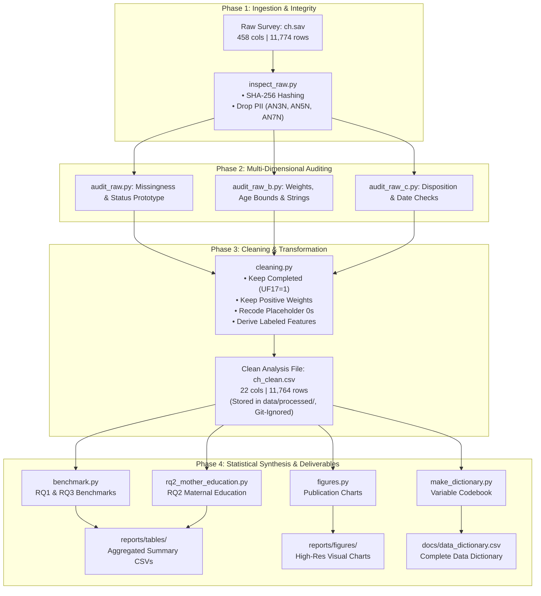

# Birth Registration Coverage and Data Preparation Across Districts of Sierra Leone: Evidence from the 2017 MICS6 for CRVS Planning

---

### Student Information
* **Student Name:** **Alfred Manso Kargbo**
* **Student ID:** **5665**
* **Class:** **DIT 2101**

---

### Project Overview
An empirical survey data science study analyzing birth registration coverage, certificate possession, and socioeconomic differences among children under 5 in Sierra Leone using MICS6 survey data. This analysis provides reproducible evidence to support Civil Registration and Vital Statistics (CRVS) planning and monitoring.

---

## Table of Contents

1. [Purpose](#purpose)
2. [Research Questions](#research-questions)
3. [Data Journey: How the Data Travels](#data-journey-how-the-data-travels)
4. [Statistical Methodology: How the Statistics Work](#statistical-methodology-how-the-statistics-work)
5. [Data Access & Confidentiality](#data-access--confidentiality)
6. [Project Structure](#project-structure)
7. [How to Reproduce](#how-to-reproduce)
8. [Script Reference Table](#script-reference-table)
9. [Key Cleaning Decisions](#key-cleaning-decisions)
10. [Validation Summary](#validation-summary)
11. [Ethics](#ethics)
12. [Limitations](#limitations)
13. [Citation](#citation)

---

## Purpose

This project evaluates the completeness, disparities, and institutional awareness of civil registration and vital statistics (CRVS) for children under five years of age in Sierra Leone. Aligned with Sustainable Development Goal Target 16.9 (indicator 16.9.1) ("legal identity for all, including birth registration"), the analysis assesses the gap between formal birth registration and physical certificate possession across geographic districts, urban/rural residence, wealth quintiles, and maternal educational attainment.

---

## Research Questions

| Identifier | Research Question | Focus Area |
| :--- | :--- | :--- |
| **RQ1** | What share of children under 5 had a registered birth in 2017, and how many held a certificate? | National coverage & certification gap |
| **RQ2** | How does registration differ by district, area, wealth and mother's education? | Disparities & equity analysis |
| **RQ3** | Among unregistered children, what share of caretakers know how to register (BR3), and does this vary by district? | Institutional awareness & access barriers |
| **RQ4** | Which data-quality issues had to be fixed, and did they change the results? | Data integrity & validation audit |

---

## Data Journey: How the Data Travels

The pipeline is organized into four sequential phases, transforming raw survey data into verified, publication-grade analytical outputs while enforcing strict data hygiene and privacy guards.



### Stage-by-Stage Data Lifecycle:
1. **Raw Storage (Read-Only):** The proprietary SPSS file (`ch.sav`) sits outside version control. It is opened strictly in read-only mode by `pyreadstat`.
2. **Identification Stripping:** Direct personal names (`AN3N`, `AN5N`, `AN7N`) are stripped in memory upon ingestion across all scripts before any analysis occurs.
3. **Audit Verification:** The raw file is audited across 458 variables to evaluate survey skip patterns, missingness profiles, and interviewer disposition codes.
4. **Deterministic Filtering:** `cleaning.py` removes records with uncompleted interview status or zero weights, collapsing 456 raw columns into 22 clean analytical features.
5. **Publishable Aggregation:** Individual records are summarized into weighted statistical tables (`reports/tables/`) and plots (`reports/figures/`). No individual microdata records are ever exported to public folders.

---

## Statistical Methodology: How the Statistics Work

Survey data cannot be analyzed using simple sample percentages because MICS6 employs a stratified, multi-stage cluster sampling design. 

### 1. Survey Weighting Formulation
Children sampled from smaller districts or sparsely populated strata have different selection probabilities than those from urban centers. Each child record is assigned a calibrated sampling weight (`chweight`).

To compute unbiased population estimates, every percentage is calculated as a **weighted ratio**:

$$\text{Weighted Registration Rate } (\%) = \frac{\sum_{i \in K} w_i \cdot R_i}{\sum_{i \in K} w_i} \times 100$$

* Where:
  * $w_i$ is the child sampling weight (`chweight`).
  * $R_i \in \{0, 1\}$ is the binary registration outcome (1 if registered, 0 if not registered).
  * $K$ is the analytical population with known registration status ($N = 11,606$ after excluding unknowns).

### 2. Indicator Derivation Logic (SDG Target 16.9 / Indicator 16.9.1)
Birth registration status is derived through a standardized multi-variable decision matrix based on question modules `BR1` (certificate possession) and `BR2` (civil registration):

```
                        ┌───────────────────────────────┐
                        │ Child Interview Completed?    │
                        └──────────────┬────────────────┘
                                       │ Yes
                                       ▼
                     ┌───────────────────────────────────┐
                     │ Has Birth Certificate? (BR1)      │
                     └──────────────┬────────────────────┘
                                    │
               ┌────────────────────┴────────────────────┐
               │ 1 (Seen) or 2 (Not Seen)                │ 3 (No Certificate)
               ▼                                         ▼
      ┌──────────────────┐                     ┌───────────────────┐
      │  REGISTERED      │                     │ Registered with   │
      │  (SDG 16.9.1)    │                     │ Authority? (BR2)  │
      └──────────────────┘                     └─────────┬─────────┘
                                                         │
                                    ┌────────────────────┴───────────────────┐
                                    │ 1 (Yes)                                │ 2 (No)
                                    ▼                                        ▼
                           ┌──────────────────┐                     ┌──────────────────┐
                           │  REGISTERED      │                     │  NOT REGISTERED  │
                           └──────────────────┘                     └──────────────────┘
```

* **Registered:** Caretaker has a certificate (`BR1` = 1 or 2) OR confirms civil registration (`BR2` = 1).
* **Not Registered:** Child lacks a certificate (`BR1` = 3) AND caretaker confirms birth is not registered (`BR2` = 2).
* **Unknown:** Missing, "Don't know" (`8`), or "No response" (`9`) across both indicators.

### 3. Stratified Disaggregations
All equity indicators (district, wealth quintile, area, mother's education) apply this weighted ratio across subgroup domain subsets:

$$\text{Subgroup Rate } (\%) = \frac{\sum_{i \in \text{Subgroup}} w_i \cdot R_i}{\sum_{i \in \text{Subgroup}} w_i} \times 100$$

---

## Data Access & Confidentiality

* **Data Source:** Sierra Leone Multiple Indicator Cluster Survey 2017 (MICS6), administered by Statistics Sierra Leone with technical and financial assistance from UNICEF.
* **Module Used:** `ch.sav` (Children Under 5 Questionnaire module).
* **Restricted Access Notice:** Raw survey microdata (`ch.sav`) and cleaned individual-level data (`ch_clean.csv`) are **not included** in this repository in compliance with survey confidentiality agreements and human-subjects protections.
* **Access Protocol:** Researchers must obtain the dataset directly from the official UNICEF MICS website ([https://mics.unicef.org](https://mics.unicef.org)). Registration and formal approval are required. Users agree never to attempt re-identification of survey respondents or distribute raw survey records.

---

## Project Structure

The repository structure reflects the finalized pipeline layout:

```text
.
├── .gitignore
├── README.md
├── requirements.txt
├── docs/
│   ├── data_dictionary.csv
│   └── registration.jpeg
├── notebooks/
├── reports/
│   ├── figures/
│   │   ├── fig1_registration_by_district.png
│   │   ├── fig2_registration_by_area.png
│   │   └── fig3_registration_by_wealth.png
│   └── tables/
│       ├── audit_missing_by_column.csv
│       ├── audit_reg_rate_by_area.csv
│       ├── audit_reg_rate_by_district.csv
│       ├── audit_reg_rate_by_wealth_quintile.csv
│       ├── audit_reg_status_counts.csv
│       ├── audit_string_columns.csv
│       ├── benchmark_sex_area.csv
│       ├── clean_exclusion_log.csv
│       ├── clean_validation_before_after.csv
│       ├── fig1_rates_by_district.csv
│       ├── fig2_rates_by_area.csv
│       ├── fig3_rates_by_wealth.csv
│       ├── raw_counts_BR1.csv
│       ├── raw_counts_BR2.csv
│       ├── raw_counts_BR3.csv
│       ├── raw_counts_HH6.csv
│       ├── raw_counts_HH7.csv
│       ├── raw_counts_HH7A.csv
│       ├── raw_missing_key_vars.csv
│       ├── rq2_by_mother_education.csv
│       ├── rq3_br3_overall.csv
│       └── rq3_by_area_district.csv
└── src/
    ├── inspect_raw.py
    ├── audit_raw.py
    ├── audit_raw_b.py
    ├── audit_raw_c.py
    ├── cleaning.py
    ├── benchmark.py
    ├── figures.py
    ├── make_dictionary.py
    └── rq2_mother_education.py
```

---

## How to Reproduce

Follow these steps to set up the environment and reproduce all outputs from the source survey file:

### 1. Environment Setup

Create and activate a virtual environment, then install the pinned project dependencies:

```bash
# Create virtual environment
python3 -m venv .venv

# Activate virtual environment
source .venv/bin/activate

# Install required dependencies
pip install -r requirements.txt
```

### 2. Configure Data Location

Place your authorized copy of `ch.sav` in a secure local folder outside version control, then export the path:

```bash
export MICS_CH_SAV="/path/to/ch.sav"
```

### 3. Run Pipeline Scripts

Execute the pipeline scripts in sequential order to perform data auditing, cleaning, benchmarking, and figure generation:

```bash
# Phase 1: Raw data inspection and cryptographic hashing
python src/inspect_raw.py

# Phase 2: Core and extended raw data audits
python src/audit_raw.py
python src/audit_raw_b.py
python src/audit_raw_c.py

# Phase 3: Data cleaning and derivation
python src/cleaning.py

# Phase 4: Analysis, benchmarking, dictionary, and figures
python src/benchmark.py
python src/figures.py
python src/make_dictionary.py
python src/rq2_mother_education.py
```

---

## Script Reference Table

| Execution Order | Script | One-Line Purpose | Output Location |
| :---: | :--- | :--- | :--- |
| **1** | `src/inspect_raw.py` | Inspects raw file metadata, computes SHA-256 hash, drops identifying columns, and exports initial missingness and frequency tables. | `reports/tables/` |
| **2** | `src/audit_raw.py` | Audits core variables (BR1, HH7A), prototypes registration status logic, and calculates preliminary group registration rates. | `reports/tables/` |
| **3** | `src/audit_raw_b.py` | Conducts extended audits on weight distribution, age consistency, string columns, and whole-table missingness. | `reports/tables/` |
| **4** | `src/audit_raw_c.py` | Checks interview disposition (UF17), zero-weight cases, exact age differences (CDOI vs. CDOB), and missing geographic cases. | Console output |
| **5** | `src/cleaning.py` | Filters valid completed records, recodes placeholders, drops PII names, verifies hash immutability, and outputs `ch_clean.csv`. | `data/processed/`, `reports/tables/` |
| **6** | `src/benchmark.py` | Evaluates cleaned data against published national benchmarks and produces core tables for RQ1 and RQ3. | `reports/tables/` |
| **7** | `src/figures.py` | Generates publication figures (Figures 1–3) and associated rate tables across districts, areas, and wealth quintiles. | `reports/figures/`, `reports/tables/` |
| **8** | `src/make_dictionary.py` | Constructs and saves the comprehensive variable data dictionary to `docs/data_dictionary.csv`. | `docs/` |
| **9** | `src/rq2_mother_education.py` | Evaluates RQ2 by computing weighted and unweighted birth registration rates across maternal education levels. | `reports/tables/` |

---

## Key Cleaning Decisions

The data preparation pipeline implemented five foundational rules to ensure data reliability:

1. **Inclusion Criteria:** Retained only completed child interviews (`UF17 == 1`) with valid sampling weights (`chweight > 0`). Incomplete, absent, or refused interviews lacking usable answers and carrying zero weight were removed.
2. **Placeholder Handling:** Converted non-substantive zero values in `windex5` (wealth index quintile) to missing (`NaN`).
3. **Skip-Pattern Alignment:** MICS questionnaire skip patterns in `BR2` (registration when certificate not possessed) and `BR3` (knowledge of registration procedure) were preserved and explicitly labeled as `"Not asked (skip pattern)"`.
4. **SDG Target 16.9 (indicator 16.9.1) Registration Definition:**
   * **Registered:** Child has a birth certificate seen (`BR1 == 1`), certificate not seen (`BR1 == 2`), or caretaker reports registration with civil authorities (`BR2 == 1`).
   * **Not registered:** Caretaker reports child is not registered (`BR2 == 2`) and no certificate exists (`BR1 == 3`).
   * **Unknown:** Missing, "Don't know" (`8`), or "No response" (`9`) on both indicators.
5. **Privacy Enforcement:** Direct personal identifiers (`AN3N`, `AN5N`, `AN7N`) were dropped upon initial data loading and are excluded from any processed exports.

---

## Validation Summary

The automated validation checks in `cleaning.py` confirmed the following findings:

| Metric / Check | Value / Result | Description |
| :--- | :--- | :--- |
| **Record Count Transition** | **11,774 to 11,764 records** | 10 non-completed/zero-weight records appropriately excluded |
| **Variable Reduction** | **456 to 22 variables** | Focused analytical subset produced from high-dimensional raw file |
| **Automated Checks** | **9 automated checks passed** | Full pass on logical bounds, skip logic, weights, and districts |
| **Raw File Immutability** | **Raw-file hash unchanged** | Cryptographic SHA-256 match confirms raw data remained read-only |
| **National Benchmark** | **81.1% weighted registration** | Matches published national figure of about 81% over all children |

---

## Ethics

* **Vulnerable Population Protection:** The survey assesses children under five years of age and their households. Research procedures adhere strictly to international standards for ethical research with children.
* **De-identification & Anonymity:** Direct identifying name fields (`AN3N`, `AN5N`, `AN7N`) are stripped at the moment of loading. Only aggregate summary statistics, non-identifying charts, and metadata dictionaries are published.
* **Repository Safety:** Restricted microdata is prohibited from public version control through comprehensive `.gitignore` rules.

---

## Limitations

* **Cross-Sectional Design:** The survey reflects observational cross-sectional data collected in 2017, precluding causal claims regarding the impact of maternal education or household wealth on birth registration.
* **Recall & Reporting Bias:** For children lacking a physical certificate, registration status and knowledge of procedures rely on maternal/caretaker recall.
* **Denominator Exclusions:** Children with "Unknown" registration status (~1.3% of the sample) are excluded from rate calculations.
* **Survey Design Simplification:** Routine analysis utilizes primary child weights (`chweight`); complex survey clustering and stratification adjustments should be applied for formal variance estimation.

---

## Citation

```text
[Insert APA Reference Here]
```

Statistics Sierra Leone, & UNICEF. (2018). *Sierra Leone Multiple Indicator Cluster Survey 2017, Survey Findings Report*. Freetown, Sierra Leone: Statistics Sierra Leone.

